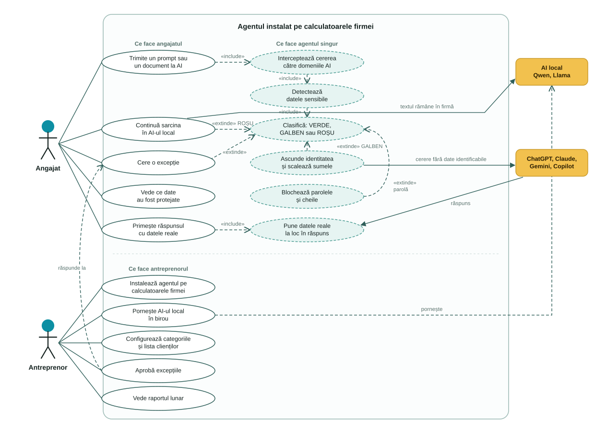
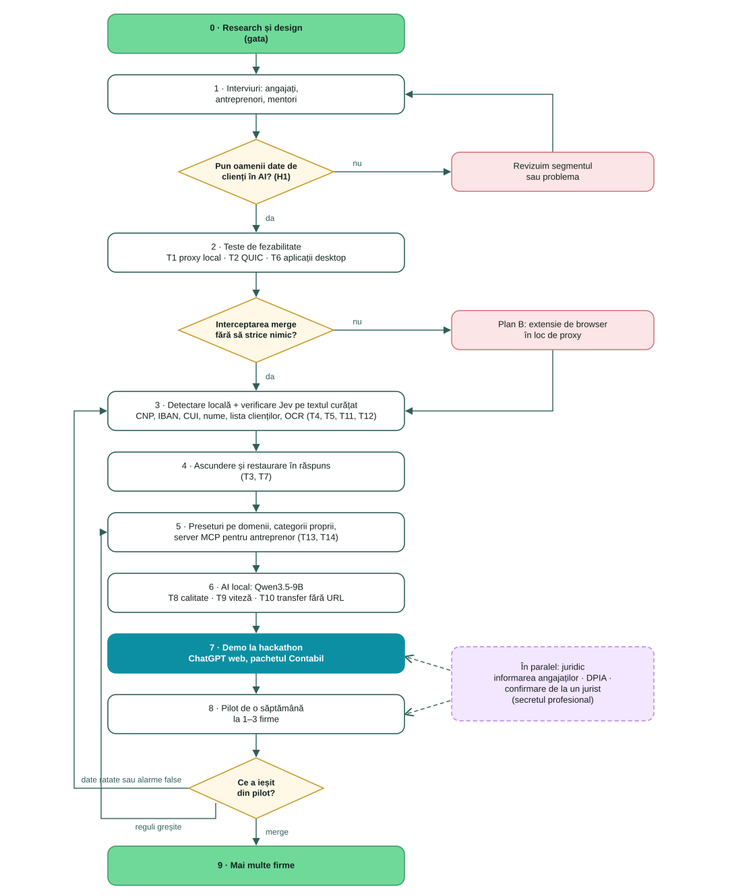

# 09 · Diagrame: cazurile de utilizare și fluxul de dezvoltare

> Diagramele descriu soluția **proiectată** din [06-solutie.md](06-solutie.md). Nimic nu e construit încă. Sursa lor e scriptul care desenează SVG-urile din [diagrame/](diagrame/). Pagina cu ambele e [diagrame.html](diagrame.html).

## 1. Diagrama cazurilor de utilizare

Cum se citește:
- **Linia plină** leagă un actor de ce face el.
- **Linia punctată** arată ce face agentul singur: „include” se întâmplă de fiecare dată, „extinde” doar într-un caz anume (GALBEN, ROȘU, parolă).
- **Galben:** sisteme din afara agentului.

| Actor | Ce face |
|---|---|
| **Angajatul** | Lucrează în ChatGPT ca până acum, primește răspunsul cu datele reale și vede ce s-a protejat. Pe ROȘU continuă sarcina în AI-ul local sau cere o excepție |
| **Antreprenorul** | Instalează agentul, pornește AI-ul local, alege presetul pentru domeniul firmei, adaugă date sensibile pe categorii, aprobă excepțiile și își întreabă asistentul AI despre date, prin serverul MCP |
| **ChatGPT, Claude, Gemini, Copilot** | Sistem extern: primește doar cereri fără date identificabile |
| **Jev (TypeSafe), în cloud** | Sistem extern: primește doar textul deja curățat, ca a doua verificare înainte de trimitere (vezi [10 §2](10-integrari.md)) |
| **AI local (Qwen3.5-9B)** | Sistem care rulează în firmă: primește sarcinile ROȘU, iar textul nu iese din firmă |

## 2. Fluxul de dezvoltare al aplicației

Fiecare romb e un punct de decizie: nu trecem mai departe până nu avem dovada din test sau din interviuri. Numerotarea testelor (T1–T10) e cea din [06](06-solutie.md).

| Etapa | Ce o deblochează | Dacă nu merge |
|---|---|---|
| 1 · Interviuri | Citate care confirmă H1 | Schimbăm segmentul sau problema |
| 2 · Fezabilitate | T1, T2, T6 trecute | Plan B: extensie de browser [I] |
| 3–4 · Detectare și restaurare | T3, T4, T5, T7 trecute | Mai multe categorii pe ROȘU până se îmbunătățește detectarea |
| 5 · Categorii și raport | Antreprenorii din interviuri înțeleg raportul | Simplificăm categoriile la pachetele pe segmente |
| 6 · AI local | T8, T9, T10 trecute | ROȘU rămâne blocare cu explicație |
| 7 · Demo | Pașii 3–5, plus 6 dacă e gata | Arătăm un singur caz, cap-coadă |
| 8 · Pilot | Acordul unei firme | Înapoi la interviuri, după prezentări noi |

[I] Planul B (extensia de browser) e ipoteza noastră. Prinde doar ChatGPT, Claude și Gemini din browser, nu și aplicațiile desktop.
